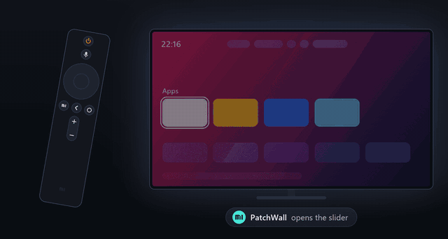

# Xiaomi TV Backlight Control

Приложение управляет подсветкой Xiaomi TV с пульта. Назначьте PatchWall или другую
поддерживаемую кнопку в настройках приложения. Нажмите её, чтобы открыть шкалу,
затем меняйте уровень кнопками ↑ / ↓. Повторное нажатие или «Назад» закрывает шкалу.



Дополнительная [интеграция Home Assistant](https://github.com/alexshemr/ha-xiaomi-tv-backlight)
добавляет сущность подсветки для автоматизаций, например для приглушения экрана ночью.

## Установка и разрешения

1. Скачайте [Platform-Tools для Windows](https://developer.android.com/tools/releases/platform-tools)
   и распакуйте в `C:\platform-tools`. Сохраните [APK](https://github.com/alexshemr/xiaomi-tv-backlight-control/releases/latest)
   в ту же папку или установите его на ТВ с флешки.

2. Подключите ПК и ТВ к одной локальной сети и включите отладку ADB на телевизоре.
   Откройте PowerShell и выполните:

   ```powershell
   cd C:\platform-tools

   # Вместо 192.168.1.1 укажите IP-адрес телевизора в локальной сети
   .\adb.exe connect 192.168.1.1:5555
   ```

   Подтвердите запрос отладки на экране ТВ, затем выполните:

   ```powershell
   # Пропустите эту строку, если APK уже установлен с флешки
   .\adb.exe install -r xiaomi-tv-backlight-control.apk
   .\adb.exe shell pm grant local.ha.tvbacklight android.permission.WRITE_SECURE_SETTINGS
   ```

   Последняя команда один раз выдаёт доступ к подсветке. Она нужна и после
   установки с флешки. Обычного переключателя для этого разрешения в настройках нет.

3. Откройте Настройки ТВ → Настройки устройства → Специальные возможности
   и включите службу **Подсветка Xiaomi TV**. На английском она называется
   **Xiaomi TV Backlight Control**. Служба получает нажатия горячей кнопки
   и стрелок поверх других приложений. Если кнопка в приложении не открывает
   этот раздел, перейдите в него через настройки телевизора.

4. Вернитесь в приложение, выберите «Назначить кнопку» и нажмите PatchWall.
   Теперь она открывает шкалу подсветки вместо прежнего действия.
   Для других кнопок используйте «Проверить кнопку». Некоторые прошивки
   обрабатывают кнопки приложений раньше, чем их получает служба.

5. Выключите ADB. Кнопка и подключение к Home Assistant работают без отладки,
   в том числе после перезагрузки.

В приложении показаны статусы службы специальных возможностей и разрешения ADB: зелёный или красный индикатор и подсказки по настройке. Если прошивка не поддерживает прямой переход, кнопка открывает настройки ТВ и показывает путь к разделу.

## Выключение экрана

В приложении можно включить **«Выключать экран при 0%»**, назначить отдельную
кнопку гашения или использовать оба варианта. По умолчанию обе опции выключены.
Настройка 0% действует и на команды Home Assistant.

При погашенном экране ↑ возвращает изображение с 0% на 5%. Другие кнопки
включают экран, поглощая это нажатие. Исключения — питание и назначенная кнопка
гашения. Навигацию, громкость, меню, питание и голосового помощника назначить
горячими кнопками нельзя.

## Проверенная конфигурация

**Xiaomi MiTV-MSSP1 (nino), Android TV 9, PI.5925.**
Английский и русский языки, системная светлая или тёмная тема.

На тестовом ТВ установлен [CleanYourTV](https://github.com/Gathin23/cleanyourtv).
PatchWall отключён, его кнопка открывает шкалу подсветки.
Другие прошивки Xiaomi могут иначе обрабатывать подсветку и кнопки пульта.

[English](README.md)
